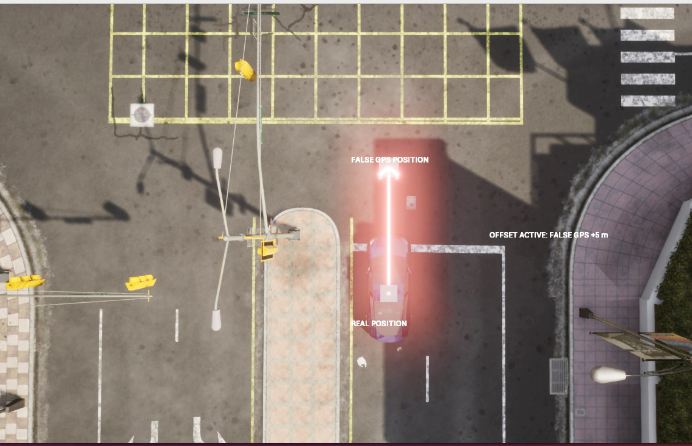
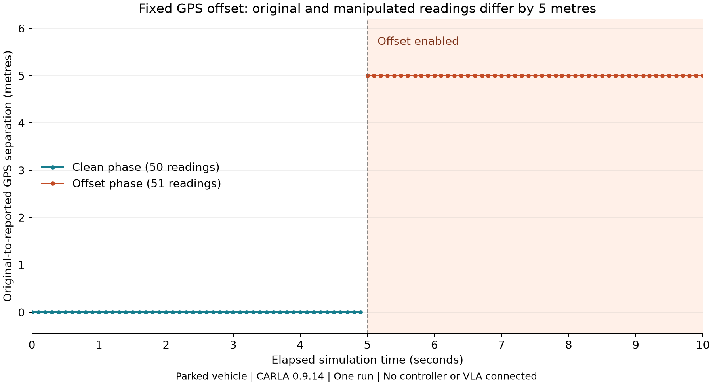

# GPS-VISUAL-01: fixed GPS offset with a visual explanation

**Completed: the same five-metre GPS-output manipulation with markers added in CARLA. Driving/VLA effects remain untested.**

Owner: Saif. Run identifier: `gps_offset_visual_20261017T214633_130642Z`.
Recorded start identifier: 2026-10-17 21:46:33 UTC, equivalent to 2026-10-18 00:46:33 Cairo. This timestamp is created before the initial viewing pause; it is not the timestamp of the first sensor sample.

## What happened

The visual script spawned a parked Tesla Model 3 in Town10HD_Opt, with CARLA client and server 0.9.14. It attached a GNSS sensor, recorded five clean simulation seconds, then applied the geographic equivalent of a +5 m offset along map X for five simulation seconds. It saved the original and manipulated GPS coordinates together. The visualization did not replace the manipulation: both were executed.

The green marker identifies the real position. The red marker identifies the false reported GPS position. The red arrow illustrates the five-metre position difference, not a driven path. Markers are raised above the car for visibility; this does not represent an altitude attack. The script pauses before recording and after recording to allow viewing and screenshots.



The screenshot was supplied by Saif in this conversation after executing the visual script. It shows the labels and offset arrow. It is archived unedited. Its exact capture frame is not recorded, so it is illustrative evidence of the demonstration, not a frame-matched sensor measurement. The red glow partly obscures the car; improving that appearance is pending, not an implemented change.

## Recorded results

| Measurement | Result |
|---|---|
| Total readings | 101 |
| Clean / attacked readings | 50 / 51 |
| First attacked sample | 5.000160 simulated seconds |
| Last recorded sample | 9.997508 simulated seconds |
| Approximate horizontal position difference during attack | 5.0000 m throughout, rounded |
| Maximum recorded sensor XYZ movement relative to first sample | 0.000000 m |
| Archived-data validation | All 13 checks passed |
| Controller, VLA, route, safety effect | Not tested |



The graph and `validation.json` were generated locally from this run's transferred CSV. They do not reuse the earlier run's data. Distance is a spherical Haversine approximation with radius 6378137 m. This run used asynchronous simulation with no fixed timestep; the sample count is observed, not guaranteed on reruns.

## Evidence and provenance

Original source directory: `/home/g02-f26/thesis-gps/results/gps_offset_visual_20261017T214633_130642Z/`.
Original CSV and metadata were downloaded through RustDesk File Transfer and preserved unchanged. No measurements were added or reconstructed. `gps_offset_visual.py` is the supplied script executed by Saif; it remains separate from the simpler fixed-offset script.

| Raw file | SHA-256 |
|---|---|
| `readings.csv` | `f4a52051dc11bfd4db98bb9c9a0600f9916a04a4aa403ba0642c676cc3b96585` |
| `metadata.json` | `009997f20cb1727e117fba11adae09c29ecd3fc9dfb58ce36be7cd8ed014dad8` |

## Run again

Keep CARLA running, then use the existing university environment:

```bash
conda activate carla
cd ~/thesis-gps
python -u gps_offset_visual.py
```

At the first prompt, inspect the car, then press Enter in the terminal to start. At the final prompt, take screenshots or a recording before pressing Enter again. Final Enter removes the test objects and writes metadata. CSV recording has already finished before that final viewing pause. Each rerun saves a separate timestamped folder.

## Draft for the shared progress document

| Sensor | Type of attack | Outcome on CARLA | Physical equivalent | Completed by | Code found in | Sources |
|---|---|---|---|---|---|---|
| GPS/GNSS | Fixed +5 m map-X position offset, with visual markers | 50 clean and 51 manipulated readings; approximately 5 m position difference verified. CARLA displays the real and false reported positions. No driving/VLA effect tested. | Software emulation of false GPS position reporting; no radio-frequency attack tested | Saif | `gps_offset_visual.py`, plus the archived run folder | Official CARLA Python API and GNSS sensor documentation |

The Google Doc has not been edited.

## Interpretation

This confirms manipulation of our Python program's reported GPS output and visualizes the position error. The original CARLA sensor data and physical vehicle remain unchanged. The false output has not been connected to a controller or VLA. These readings are not independent attack trials, and this demonstration does not establish an end-to-end attack success rate.

## Implementation references

- [CARLA 0.9.14 GNSS sensor](https://carla.readthedocs.io/en/0.9.14/ref_sensors/#gnss-sensor)
- [CARLA Python API, including DebugHelper](https://carla.readthedocs.io/en/0.9.14/python_api/#carla.DebugHelper)
