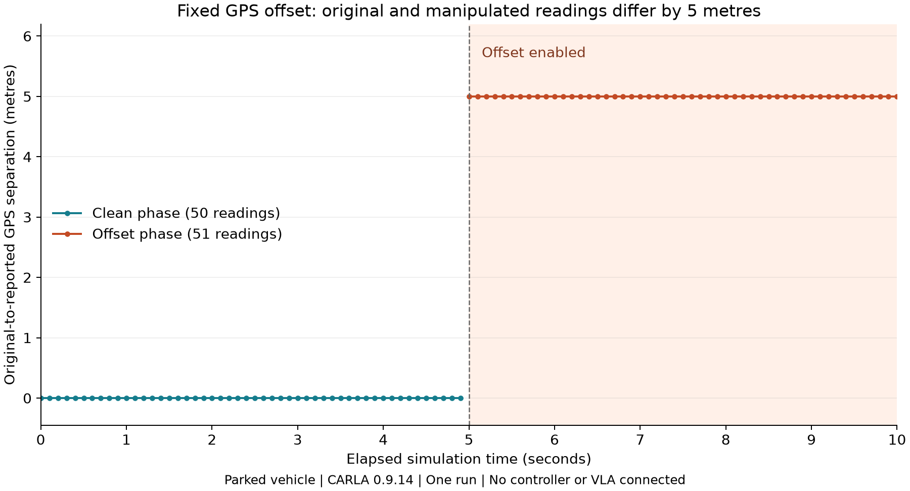

# GPS-OFFSET-01: fixed position offset

**Result: GPS-output manipulation verified. Driving impact has not been tested.**

Owner: Saif. Original execution: university Ubuntu PC through RustDesk.
Run identifier: `gps_fixed_offset_20261017T211819_023749Z`. Recorded start: 2026-10-17 21:18:19 UTC (2026-10-18 00:18:19 Cairo).

## What we did

We spawned a parked Tesla Model 3 in CARLA 0.9.14 on Town10HD_Opt and attached a GNSS sensor. The script requested readings every 0.1 simulation seconds, with the configured GNSS noise biases and standard deviations set to zero. The first five simulation seconds were clean. From five seconds onward, the script added the geographic equivalent of a +5 m shift along the map's X axis to its reported GPS output. The original sensor data and the physical vehicle were left unchanged. No navigation component received the manipulated output.

This is a software emulation of false GPS position reporting. It does not implement radio-frequency GPS spoofing, reproduce a physical transmitter, or modify the underlying CARLA sensor object.

## Observed results

| Measurement | Observed result |
|---|---|
| Total readings | 101 |
| Clean / attacked readings | 50 / 51 |
| First attacked sample | 5.001833 simulated seconds |
| Last recorded sample | 9.999954 simulated seconds |
| Approximate original-to-reported horizontal separation during attack | 5.0000 m throughout, rounded to four decimals |
| Original sensor XYZ variation relative to first sample | 0.000000 m |
| Clean coordinates preserved | All 50 readings |
| Attacked coordinates altered | All 51 readings |
| Driving / VLA effect | Not evaluated |

The recorded original latitude was -0.00021982682488896899 degrees and longitude was -0.0005807145145428739 degrees throughout this run. During the attack, reported longitude became -0.0005357987503368977 degrees; latitude and altitude were unchanged. These are simulated map coordinates, not the university's geographical position.

The count is an observation, not a fixed requirement. The recording uses sensor timestamps and an interval ending before ten seconds; the final sample was just below ten seconds. No exact 100-reading count is enforced.



The graph uses the saved CSV measurements. The shaded area marks the configured attack interval, starting at five simulated seconds. The first affected sample arrived at 5.001833 seconds. Horizontal separation uses a spherical Haversine approximation with radius 6378137 m; it is not an ellipsoidal geodesic measurement.

## Validation and provenance

The original `readings.csv` and `metadata.json` were downloaded directly through RustDesk File Transfer from `/home/g02-f26/thesis-gps/results/gps_fixed_offset_20261017T211819_023749Z/`. Raw files were preserved unchanged. No missing measurements were invented.

`validation.json` was generated locally from the transferred files. All 13 checks passed, covering numeric validity, clean and attacked coordinates, configured offsets, phase timing, increasing frames and timestamps, sample counts, approximate displacement, and recorded sensor motion. The analysis did not rerun CARLA.

| Original file | SHA-256 |
|---|---|
| `readings.csv` | `1117dd39783399ad73d2282baf4a32d6f45f41b6cde5abb7524112c462a1f385` |
| `metadata.json` | `ddacd7ff40c2a02a9fcb950ac9089542644f2366a711410fe53e0de275a2d5f0` |

## How to reproduce

On the university PC with CARLA running, activate the existing environment, enter the scripts folder, and run:

```bash
conda activate carla
cd ~/thesis-gps
python -u gps_fixed_offset.py
```

Each run creates its own timestamped folder under `results/`, containing readings and settings. It removes its test vehicle and sensor after recording. It refuses to run in a synchronous world without further review. This recorded world was asynchronous with no fixed timestep configured.

To recheck and plot archived data on a computer with Python and Matplotlib:

```bash
python analyze_gps_offset.py results/gps_fixed_offset_20261017T211819_023749Z
```

## Entry prepared for the team's progress document

| Sensor | Type of attack | Outcome on CARLA | Physical equivalent | Completed by | Code found in | Sources |
|---|---|---|---|---|---|---|
| GPS/GNSS | Fixed position offset: +5 m along map X after 5 clean simulation seconds | 101 readings saved: 50 clean and 51 altered. All attacked readings differed by approximately 5 m. Vehicle remained stationary in the recorded sensor positions. Driving/VLA effects not tested. | Software emulation of false GPS position reporting; no RF spoofing tested | Saif | `gps_fixed_offset.py`; run evidence in this folder | Official CARLA GNSS sensor and Python API documentation below |

This entry is a draft saved locally and in GitHub. The shared Google Doc has not been edited.

## What this does and does not establish

The experiment establishes that our script can introduce and log a controlled position error in GPS output. It is one parked-car run. It does not establish end-to-end attack success, a safety violation, robustness, attack success rate across trials, or a GPS-to-Alpamayo connection. Reading counts are not trial counts.

Next: identify the component that consumes GPS and connect the manipulated output to that interface. Then establish a moving clean baseline before comparing matched clean and attacked driving runs. Further offset, drift, or dropout tests would be separate experiments, not completed results.

## Implementation references

- [CARLA 0.9.14 GNSS sensor](https://carla.readthedocs.io/en/0.9.14/ref_sensors/#gnss-sensor)
- [CARLA 0.9.14 Python API](https://carla.readthedocs.io/en/0.9.14/python_api/)
- [CARLA simulation timing](https://carla.readthedocs.io/en/0.9.14/adv_synchrony_timestep/)
