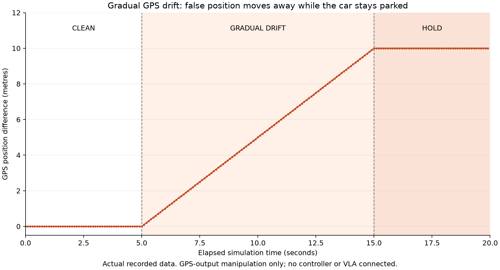
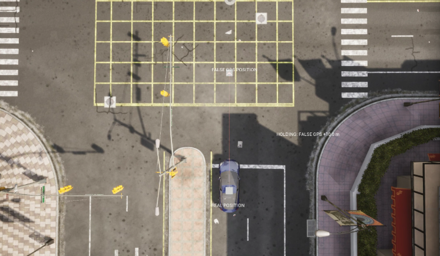

# GPS-DRIFT-01: gradual GPS position drift

**Status: GPS-output manipulation verified. Driving and VLA effects were not tested.**

Owner: Saif. Run identifier: `gps_gradual_drift_20261018T111345_116556Z`.
Run-folder timestamp: 18 October 2026, 11:13:45 UTC / 14:13:45 Cairo. The timestamp is generated before the initial viewing pause, rather than at the first recorded sensor reading.

## What we executed

We spawned a parked Tesla Model 3 and attached a GNSS sensor in CARLA 0.9.14, on Town10HD_Opt. After five clean simulation seconds, our Python program gradually changed its reported position along map X at 1 m/s for ten seconds, reaching a ten-metre offset. It then held that offset for five seconds. This differs from the earlier fixed-offset experiment, which introduced a sudden five-metre jump.

The original GNSS measurements and the physical vehicle were unchanged. The manipulated coordinates were recorded by our program; no controller or VLA received them. This is software emulation of false GPS output, not an RF transmitter or a reproduction of a complete real-world GPS-spoofing attack.

## Actual results

| Measurement | Recorded result |
|---|---|
| Total readings | 200 |
| Clean / drift / hold readings | 51 / 99 / 50 |
| First drift sample | 5.097791 simulated seconds |
| First hold sample | 15.003373 simulated seconds |
| Last sample | 19.900216 simulated seconds |
| Maximum applied map-X offset | 10 m |
| Maximum approximate geographic separation | 10.0000 m |
| Recorded sensor movement relative to first sample | 0 m |
| Data checks | All 12 passed |

The first affected sample arrived at about 5.098 seconds because the phase is applied to the next available measurement after the five-second boundary. The sample counts are observed results, not fixed quotas. The world was asynchronous with no fixed timestep configured; GNSS capture interval was set to 0.1 simulation seconds, with noise biases and standard deviations zero.



The graph is generated from the saved original and reported coordinates. It shows the clean phase, gradual growth, and ten-metre hold. Geographic separation uses a spherical Haversine approximation with radius 6378137 m, not an ellipsoidal geodesic.

## Visual evidence



The screenshot was supplied by Saif from the running demonstration and is preserved unedited. It shows the final hold phase, the parked car's real position, and the false position ten metres away. The screenshot alone does not show the preceding gradual movement; the timestamped data and graph document that progression. No exact match between the screenshot and a sensor frame is claimed. The arrow represents a position error, not a driven trajectory. Markers are raised above the roof for visibility without changing GPS altitude.

## Verification and file provenance

The checker ran on the university PC and reported all 12 checks passing. The original `readings.csv`, `metadata.json`, and `validation.json` were downloaded through RustDesk File Transfer from:

```text
/home/g02-f26/thesis-gps/results/gps_gradual_drift_20261018T111345_116556Z/
```

The downloaded raw CSV and settings match the hashes produced by that remote check. The same checker was then run locally to generate the graph, returning the same validation values. The original remote report is preserved unchanged as `validation.json`; the local report is saved separately as `validation_local.json` because platform line endings differ. No measurements were fabricated or reconstructed.

| Raw file | SHA-256 |
|---|---|
| `readings.csv` | `cec5c52673620ff1b0abdbfb085897dd40fcdf4c3e2799ff6fd2b2e8c28f7f17` |
| `metadata.json` | `bcccbd15d3d172379e7964843876c96e7370cb66d1e9dc44792b8609e7bee29c` |
| `validation.json` | `1b19f2570122bce870f2f6394907e7a9ec6e113e7fef543412a877dce8df2a9a` |

The screenshot's SHA-256 is `4b072261b81f7ac5ffa0864164e759f1d0bac0f9459f0db47a62ff7d6b9cd7f1`.

## Reproduce

With CARLA running, use the university Ubuntu terminal:

```bash
conda activate carla
cd ~/thesis-gps
python -u gps_gradual_drift.py
```

Press Enter at the initial viewing prompt to begin. At the final viewing prompt, capture the scene, then press Enter to finish cleanup. Each run creates a separate timestamped folder. Use this experiment's own checker, not the fixed-offset checker:

```bash
python check_gps_drift.py results/gps_gradual_drift_20261018T111345_116556Z
```

When checking this archived run locally, enter the experiment folder first. Add `--plot` only on a computer with Matplotlib installed.

## Draft entry for the team's progress document

| Sensor | Type of attack | Outcome on CARLA | Physical equivalent | Completed by | Code found in | Sources |
|---|---|---|---|---|---|---|
| GPS/GNSS | Gradual position drift: 0 to +10 m along map X at 1 m/s, then hold | 200 readings: 51 clean, 99 drift, 50 hold. Recorded sensor stayed stationary while reported GPS moved away. All 12 checks passed; CARLA markers and graph show the error. Driving/VLA effects not tested. | Software emulation of false GPS position reporting; no RF spoofing tested | Saif | `gps_gradual_drift.py`, `check_gps_drift.py`, and this results folder | Official CARLA documentation; related localization-spoofing research by Shen et al. (2020) |

The shared Google Doc has not been edited. This entry is prepared for a later update.

## Limits and next work

This is one parked-car run and establishes GPS-output manipulation, not end-to-end attack success. The readings are not independent attack trials and cannot be used as an attack success percentage. GPS dropout remains a possible next sensor-output experiment. Separately, we still need to identify the component that consumes GPS before measuring effects on actual driving decisions.

## References

- [CARLA 0.9.14 GNSS sensor](https://carla.readthedocs.io/en/0.9.14/ref_sensors/#gnss-sensor)
- [CARLA 0.9.14 Python API](https://carla.readthedocs.io/en/0.9.14/python_api/)
- [Shen et al. (2020), Drift with Devil](https://www.usenix.org/conference/usenixsecurity20/presentation/shen). Related research on GPS spoofing against localization fusion; this simple experiment does not reproduce FusionRipper's full adaptive algorithm or evaluation.
